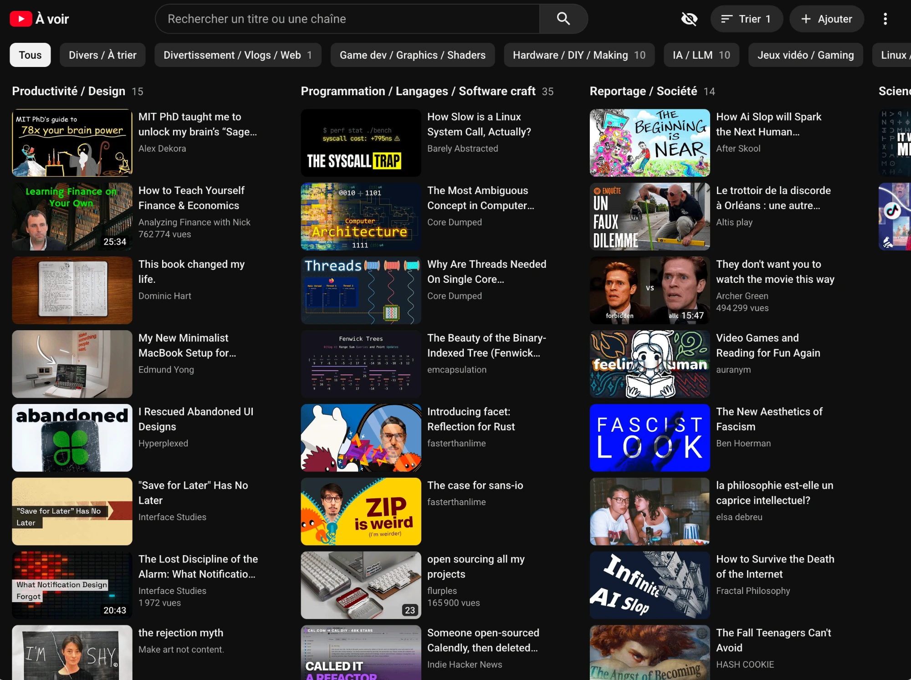

# yt-kanban

((Vibe codded stuff))
A self-hosted kanban board for the YouTube videos you want to watch, sorted by theme.



It looks and feels like YouTube (its dark and light themes, Roboto, thumbnails, ⋮ menus),
because that is where the videos come from.

- **Add**: "Add" in the top bar, then paste YouTube links, one per line, any format
  (`watch?v=`, `youtu.be/`, `shorts/`, bare ids). Title, channel, thumbnail and length are
  fetched automatically, no YouTube API key needed. New videos land in the inbox column ("Inbox" by
  default).
- **Board**: one column per theme, each a compact list like YouTube's "Up next". Click a theme
  (its chip in the filter bar, or its column title) to open it as a full-page grid, where
  "Rename" renames it (or merges it into another theme).
- **Each video**: hover the thumbnail for a ✓ that marks it watched; the ⋮ menu marks it
  watched / unwatched, moves it ("Move to…", with "New theme…" to create a theme), or removes
  it. A watched video gets YouTube's red progress bar under its thumbnail, and its length shows
  in the bottom-right corner of the thumbnail, as on YouTube ("4:07", "1:02:15"; none for a
  live stream).
- **Top bar**: search by title or channel, the eye icon shows or hides watched videos (hidden by
  default), and the ⋮ menu opens the settings and exports or imports the whole board as JSON.
- **Settings**: theme (auto, light, dark; auto follows the system) and card size (small, medium,
  large: thumbnails, columns and grid together). Saved per browser.
- **AI triage (optional)**: the "Sort N" button asks Claude to sort the inbox into your existing
  themes. You review the suggestions and untick the wrong ones before anything moves.
- Works on a phone too.

The UI is in English (your theme names can be in any language). One Docker container, one
SQLite file, about 25 MB of RAM.

## How it works

```
browser ──HTTPS──▶ your reverse proxy (TLS + login) ──▶ yt-kanban :3000
                                                         ├─ /            Vue app (web/dist)
                                                         ├─ /api/...     JSON API
                                                         └─ /thumbs/...  thumbnail cache
                                                        data/  (volume)
                                                         ├─ kanban.db         SQLite: the whole board
                                                         ├─ thumbs/           JPEGs from i.ytimg.com
                                                         └─ triage-hints.md   optional AI rules
```

- **Server** (`server/`, Node ≥ 22.13, Express, built-in `node:sqlite`, no native module):
  - `index.js`: routes;
  - `db.js`: schema and numbered migrations (`PRAGMA user_version`);
  - `youtube.js`: link parsing, oEmbed metadata, video length (YouTube Music's player
    endpoint, which still answers from server IPs, with the watch page as a fallback),
    thumbnails;
  - `lengths.js`: background lookup of missing lengths at startup and every 6 hours (a couple
    per second);
  - `triage.js`: the Claude call.
- **Frontend** (`web/`): Vue 3, Pinia, Tailwind CSS v4, built by Vite into `web/dist`, which
  the server serves. All videos are loaded once and filtered in the browser. Roboto is bundled
  (`@fontsource-variable/roboto`), so the page loads nothing from Google; the icons are Material
  Icons drawn inline (`web/src/components/Icon.vue`).
- **Thumbnails** are downloaded the first time they are requested and kept in `data/thumbs/`.
  A missing file is fetched again, so the cache can be deleted at any time.
- **AI triage** sends Claude the titles and channels of the inbox videos, the list of existing
  themes with the 12 most recent videos of each as examples, and `triage-hints.md` if present.
  A JSON schema forces the answer to be one of the existing themes or "leave it", so the model
  can neither invent a theme nor answer something unparsable. It uses Claude Haiku (the small,
  cheap model): sorting 20 videos costs well under a cent. Nothing else is sent anywhere.
- **No login in the app, on purpose.** It has no users and no passwords to store. Anyone who
  can reach port 3000 can edit the board, so **always publish it behind authentication**
  (next section).

## Install

**With an AI coding assistant** (Claude Code, Codex, Cursor…) on your server: give it this
repository's link and say "install it on this server". It follows [AGENTS.md](AGENTS.md): asks
for your domain, how to protect the app and an optional API key, installs, puts it online behind
a login, and checks everything.

**By hand**: needs Docker with the compose plugin.

```bash
git clone https://github.com/marc-alexis-com/yt-kanban.git && cd yt-kanban
cp .env.example .env            # optional settings, see below
mkdir -p data && sudo chown 1000:1000 data   # the container runs as uid 1000 (node)
docker compose up -d --build
curl -s localhost:3000/api/health   # {"ok":true}
```

The app now listens on `127.0.0.1:3000` only.

### Settings (`.env`)

| Variable | Default | |
|---|---|---|
| `INBOX_THEME` | `Inbox` | Column where new videos land; the AI triage only empties this one. |
| `ANTHROPIC_API_KEY` | (empty) | Enables the "Sort" button. Get a key from console.anthropic.com. |
| `TRIAGE_MODEL` | `claude-haiku-4-5` | Claude model used for the triage. |
| `TRIAGE_HINTS_FILE` | `/data/triage-hints.md` | Your own sorting rules, in plain language (re-read on every triage, no restart needed). |
| `PORT`, `DATA_DIR` | `3000`, `/data` | Already set in the image. |

Example `triage-hints.md`:

```markdown
- Channel "Fireship" → "IA / LLM", except videos about a programming language → "Programmation".
- Anything about Minecraft → "Jeux vidéo".
- "Stanford HCI Seminar" is reserved for that seminar's talks.
```

Themes are just names: a column exists as long as it holds a video. To start, add a few videos,
then use ⋮ → "Move to…" → "New theme…" on a video to create your first themes. A theme is
renamed (or merged into another) from its page ("Rename").

## Putting it online

Pick the one matching your server. In every case, **the login is the proxy's job**.

**Caddy** (simplest: HTTPS is automatic). Generate a password hash with
`caddy hash-password`, then add to the Caddyfile:

```caddy
yt.example.com {
	basic_auth {
		me $2a$14$...hash...
	}
	reverse_proxy 127.0.0.1:3000
}
```

**Traefik**: drop the `ports:` section, put the container on Traefik's network, and add labels
to `docker-compose.yml`:

```yaml
    labels:
      - traefik.enable=true
      - traefik.http.routers.yt-kanban.rule=Host(`yt.example.com`)
      - traefik.http.routers.yt-kanban.entrypoints=websecure
      - traefik.http.routers.yt-kanban.tls.certresolver=letsencrypt
      - traefik.http.routers.yt-kanban.middlewares=my-auth@file   # basicAuth, tinyauth, Authelia…
      - traefik.http.services.yt-kanban.loadbalancer.server.port=3000
```

**Login page instead of the browser's password pop-up**: put a forward-auth service such as
[tinyauth](https://tinyauth.app) or Authelia in front. The browser then stays signed in for
weeks. When the session expires while the page is open, the app notices (API calls get
redirected to the login page) and shows a "Sign in again" banner.

**Private network only**: with Tailscale (or WireGuard), skip the proxy and bind the port to
the VPN address instead of `127.0.0.1`.

## Day to day

```bash
docker compose logs -f                 # logs (each triage error is printed here)
git pull && docker compose up -d --build   # update
```

**Backups**: everything is in `data/kanban.db`. Copy it safely while the app runs with
`sqlite3 data/kanban.db ".backup kanban-$(date +%F).db"`, or use ⋮ → "Export (JSON)" in the top bar
(a JSON file you can re-import anywhere). Thumbnails need no backup.

**Moving to another server**: export from the old one, import into the new one (import merges
by URL: new videos are added, existing ones take the imported theme and watched state).

**Video lengths**: fetched when a video is added. Videos without one (an older board, an
import) are looked up in the background at startup and every 6 hours, about two per second, so
a board of a few hundred videos fills in within minutes; the logs print `lengths: ...` lines.
From a server IP, YouTube's regular player asks to "sign in to confirm you're not a bot", so the
lookup uses YouTube Music's public player endpoint (no key, no account). If YouTube ever
changes it, lengths stay empty and nothing else breaks.

## API

All JSON. Handy for scripts (behind your proxy, add its credentials).

| | |
|---|---|
| `GET /api/videos` | all videos |
| `POST /api/videos` `{ urls: "one link per line" }` | add; returns `{ added, ignored }` |
| `PATCH /api/videos/:id` `{ theme?, viewed? }` | move and/or mark watched |
| `DELETE /api/videos/:id` | delete |
| `POST /api/themes/rename` `{ from, to }` | rename (or merge) a theme |
| `POST /api/triage/suggest` | AI suggestions for the inbox, nothing is moved |
| `POST /api/triage/apply` `{ assignments: [{ id, theme }] }` | apply suggestions (only moves videos still in the inbox) |
| `GET /api/export`, `POST /api/import` | JSON export / import |
| `GET /api/config`, `GET /api/health` | inbox name and triage availability, health check |

## Development

```bash
pnpm install
DATA_DIR=./data pnpm dev:server   # API on :3000 (restarts on change)
pnpm dev                          # UI on :5173 with hot reload, proxies /api to :3000
```

## License

MIT, see [LICENSE](LICENSE).
